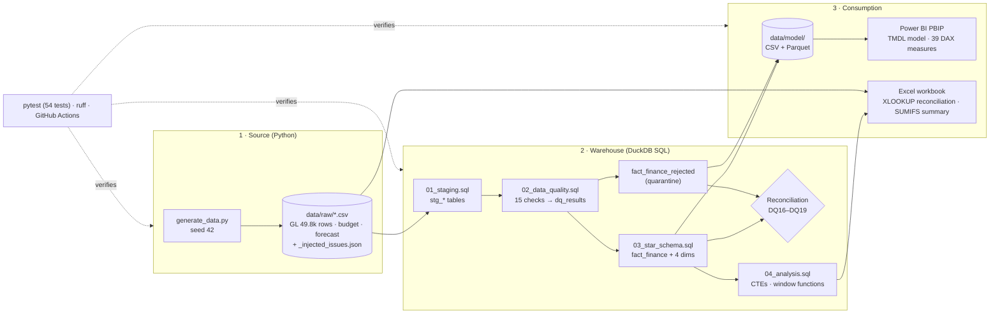

# Controlling Cockpit: Budget vs. Actual with trusted numbers

**An end-to-end controlling BI project: synthetic general-ledger data → SQL warehouse with
data-quality gates → star schema → Excel reconciliation → Power BI semantic model (PBIP/TMDL).**


---

## The business problem

Every month, a controlling team answers the same questions: *Are we on budget? Where are we
off, and why? Will we hit the year?* Variance discussions fall apart when someone asks
**"are these numbers even right?"**: a duplicated invoice, a booking without a cost centre,
or revenue posted with the wrong sign moves the result, and trust is gone.

This project builds a Budget vs. Actual cockpit for the fictional **Nordwerk GmbH** (€59–69M
revenue, 8 cost centres, 3 regions, FY2023–FY2025) where **every euro is accounted for**:

- **Data-quality gates** catch 5 types of booking errors, which were injected into the data on purpose.
- **Bad rows are quarantined, not silently dropped**, and each carries a reason.
- **Reconciliation to the cent**: ledger total = loaded actuals + quarantined amount (SQL *and* Excel).
- A **Power BI semantic model** with 39 documented DAX measures for variance, YTD, YoY, margins and forecast accuracy.
- A structured, honest **evaluation template for Microsoft Copilot** in controlling.

## Architecture



## Tech stack

| Area | Tools |
|---|---|
| Data generation | Python 3.11+, NumPy, pandas (fixed seed → byte-identical output) |
| SQL & modelling | DuckDB (ANSI-style SQL, [dialect notes](docs/sql_dialect_notes.md)), star schema (Kimball) |
| Data quality | SQL check catalog, row-level flags, quarantine table, control totals |
| Excel | openpyxl: XLOOKUP, SUMIFS, conditional formatting, data validation, Excel Table |
| Power BI | PBIP project, TMDL semantic model, Power Query (M) with a folder parameter, DAX |
| Engineering | pytest, ruff, Makefile, GitHub Actions CI |

## Quick start

```bash
git clone https://github.com/<your-user>/controlling-cockpit.git && cd controlling-cockpit
make setup      # venv + dependencies
make all        # data → warehouse + DQ → star schema → exports → Excel
```

Then `make test` (54 tests), `make analysis` (prints the SQL analyses) or `make help`.

Power BI (Windows): open `powerbi/ControllingCockpit.pbip` → *Transform data → Edit
parameters* → set `DataFolder` to your `…\data\model\` folder → *Refresh*. The star-schema
files in `data/model/` are committed, so this works right after cloning.

## KPI definitions

| KPI | Formula | Business meaning |
|---|---|---|
| **Actual / Budget / Forecast** | Σ amount for the scenario (natural sign) | What was booked / planned / expected now |
| **Variance (Abs)** | Actual − Budget | Size of the deviation in € (for costs, + = over budget) |
| **Variance %** | (Actual − Budget) / \|Budget\| | Deviation relative to plan, so small and large cost centres can be compared |
| **Variance (P&L Impact)** | (Actual − Budget) × sign | Sign-aware: **+ = good for profit**, − = bad, for revenue *and* cost lines. Drives the red/green colours |
| **Actual YTD / Budget YTD** | Σ from the start of the fiscal year to the selected month | Cumulative progress against the year's plan |
| **Actual PY** | Actual for the same period last year | Baseline for growth |
| **YoY %** | (Actual − Actual PY) / \|Actual PY\| | Growth versus last year |
| **Gross Margin %** | (Revenue − COGS) / Revenue | Pricing power and production efficiency |
| **Operating Margin (EBIT) %** | (Revenue − COGS − OpEx) / Revenue | Operating profitability |
| **Forecast Accuracy %** | 1 − Σ\|Actual − Forecast\| / Σ\|Actual\| at month × account × cost centre (1 − WAPE) | Planning quality; errors can't cancel each other out |
| **Budget Consumption %** | Actual YTD / full-year Budget | "How much of this year's budget is already spent?" (early warning) |
| **Clean Row Rate %** | (ledger rows − rejected rows) / ledger rows | Share of bookings that passed every ERROR check |

All 39 measures, with descriptions and format strings: [`powerbi/measures.dax`](powerbi/measures.dax).

## Data-quality approach

About 2 % of the ledger rows contain errors that were injected on purpose. Each one is logged in
`data/raw/_injected_issues.json`, and the tests prove that **every single one** is found by the
matching check, with no false positives.

| Check | Category | Severity | Injected | Detected |
|---|---|---|---:|---:|
| DQ01 duplicate booking (same document ref + account + amount) | Duplicates | ERROR | 300 | 300 |
| DQ02 missing cost centre | Mandatory fields | ERROR | 200 | 200 |
| DQ04 unknown account code | Orphan keys | ERROR | 200 | 200 |
| DQ06 negative revenue (sign error) | Sign plausibility | ERROR | 150 | 150 |
| DQ08 wrong / invalid period | Period validity | ERROR | 150 | 150 |
| DQ03, DQ05, DQ07, DQ09–DQ15 (nulls, orphan cost centres, negative costs, currency, budget/forecast keys, grain, periods) | various | ERROR/WARNING | 0 | 0 (PASS) |
| DQ16–DQ19 control totals (ledger = loaded + quarantined; rows; budget) | Reconciliation | ERROR | – | PASS |

Design principles:

1. **Check catalog + row-level flags + summary.** `dq_results` lists *every* check, including
   the ones that passed. A check that ran and found nothing is information too.
2. **Severity decides the action.** `ERROR` rows go to `fact_finance_rejected` with the reason.
   `WARNING` rows (e.g. negative cost = possible credit note) are loaded and reported.
3. **Nothing disappears.** DQ17/DQ18 prove that ledger total = loaded + quarantined, in both
   € and rows. The Excel *Reconciliation* sheet repeats this with XLOOKUP, starting from a
   pandas calculation that is independent of SQL.
4. **Tested.** 54 pytest tests: reproducibility, 1:1 issue detection, reconciliation to the raw
   data, KPI values against a hand-calculated mini ledger, workbook formulas, and TMDL/DAX
   reference integrity.

## Excel reconciliation workbook

`excel/controlling_reconciliation.xlsx` (built by `make excel`):

| Sheet | Content |
|---|---|
| Summary | Budget vs. actual by department and P&L (SUMIFS), fiscal-year dropdown, traffic-light formatting |
| Reconciliation | Per account: ledger (raw) vs. warehouse (SQL) vs. quarantine via **XLOOKUP**; unexplained difference must be 0 → "ALL OK" |
| Actuals / Ledger_Totals / Quarantine | Lookup sources |
| Data | Flat fact table `tblFinance`, the source for the [pivot table (2-minute guide)](docs/excel_pivot_steps.md) |

> openpyxl cannot create native pivot tables, so the pivot is built manually in about 2 minutes. See
> [docs/excel_pivot_steps.md](docs/excel_pivot_steps.md).

## Power BI semantic model

- **Format:** Power BI Project (PBIP) with the semantic model in **TMDL**. Text-based,
  reviewable in Git, and follows Microsoft's PBIP folder structure.
- **Star schema:** `Fact Finance` → `Date`, `Account`, `Cost Centre`, `Scenario`
  (single-direction, many-to-one); `Rejected Rows` → `DQ Results` for the DQ page.
- **Date table** marked as date table (contiguous 2023-01-01…2025-12-31, `dataCategory: Time`).
- **Power Query** loads `data/model/*.csv` through a `DataFolder` parameter, with the `en-US` culture
  so German-locale machines parse decimals correctly.
- **`_Measures` table** with 39 measures in 7 display folders, each with a description and a
  format string. Implicit measures are disabled.
- **Generated from one spec:** `src/cockpit/powerbi_model.py` renders the TMDL, the report
  scaffold and `measures.dax`. A test fails if the committed files drift from the spec.
- **Report pages** (Executive Overview, Cost Centre Deep-Dive, Data Quality) are specified
  visual by visual in [docs/dashboard_spec.md](docs/dashboard_spec.md).

## Screenshots

<!-- Replace each TODO with the image once it exists, e.g.  -->

| Page | Screenshot |
|---|---|
| Executive Overview | _TODO: `docs/images/executive_overview.png`_ |
| Cost Centre Deep-Dive | _TODO: `docs/images/cost_centre_deep_dive.png`_ |
| Data Quality | _TODO: `docs/images/data_quality.png`_ |
| Model view (star schema) | _TODO: `docs/images/model_view.png`_ |
| Excel reconciliation | _TODO: `docs/images/excel_reconciliation.png`_ |

## Key findings

> _To be written after building the dashboard. Each finding should name the number, the
> driver and the recommended action._

1. **Revenue & margin:** _TODO_
2. **Cost-centre overrun:** _TODO_
3. **Cost drivers:** _TODO_
4. **Forecast quality:** _TODO_
5. **Data quality:** _TODO_

## Microsoft Copilot evaluation

[`docs/copilot_evaluation.md`](docs/copilot_evaluation.md) is a structured test protocol
with 10 prompts (DAX authoring, variance summaries, root-cause questions, Excel), a scoring
rubric, and columns for Copilot's output, the **verified value**, correctness, time saved
and risks. _Results pending: filled in after hands-on testing, not invented._

## Project structure

```text
controlling-cockpit/
├── Makefile                      # setup · data · build · quality · excel · all · test · lint
├── requirements.txt / pyproject.toml
├── src/cockpit/
│   ├── config.py                 # paths & constants
│   ├── generate_data.py          # Step 1 – synthetic GL, budget, forecast + injected issues
│   ├── warehouse.py              # Step 2 – runs SQL, exports star schema, DQ report CLI
│   ├── excel_workbook.py         # Step 3 – reconciliation workbook
│   └── powerbi_model.py          # Step 4 – renders TMDL, PBIR scaffold, measures.dax
├── sql/
│   ├── 01_staging.sql            # raw CSV → staging
│   ├── 02_data_quality.sql       # check catalog, row flags, dq_results
│   ├── 03_star_schema.sql        # dims, fact, quarantine, post-load reconciliation
│   └── 04_analysis.sql           # BvA, YoY, top-5 overruns, running YTD, margins, accuracy
├── data/
│   ├── raw/                      # generated (dims committed; GL/budget/forecast via make data)
│   ├── sample/                   # first 500 ledger rows for a quick look
│   └── model/                    # star schema CSV + Parquet (committed, Power BI source)
├── excel/controlling_reconciliation.xlsx
├── powerbi/
│   ├── ControllingCockpit.pbip
│   ├── ControllingCockpit.SemanticModel/   # definition.pbism + definition/*.tmdl
│   ├── ControllingCockpit.Report/          # definition.pbir + PBIR pages
│   └── measures.dax
├── docs/
│   ├── dashboard_spec.md  data_dictionary.md  copilot_evaluation.md
│   ├── excel_pivot_steps.md  sql_dialect_notes.md
│   └── images/                   # screenshots
├── tests/                        # 54 pytest tests
└── .github/workflows/ci.yml      # make setup · lint · all · test
```

## Design decisions and limitations

- **Why DuckDB?** A real SQL engine with no server to install, and it runs identically on macOS and in CI.
  The SQL stays portable (see [dialect notes](docs/sql_dialect_notes.md)).
- **Natural sign + sign column** instead of storing costs as negative numbers. Controllers read
  costs as positive; the P&L sign is applied once, in the model.
- **Monthly fact grain.** Budget and forecast are monthly, so actuals are aggregated to the
  month. `line_count` keeps the link to the transaction level for reconciliation.
- **Quarantined actuals are excluded** from the KPIs, so the reported actuals are slightly
  understated until the source errors are fixed. That is intentional and shown on the DQ page.
- **Synthetic data:** patterns (seasonality, growth, one structurally over-budget cost
  centre, a revenue miss in 2024) were designed on purpose. They are not real company data.
- **Power BI Desktop is Windows-only.** The TMDL was written by following Microsoft's documentation and
  checked by structural tests, but it was not opened in Desktop while this was built on macOS.

## License

[MIT](LICENSE)
