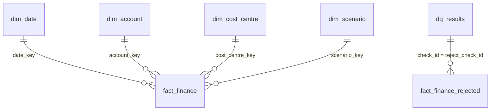

# Data dictionary

Layers: **raw CSV** (`data/raw/`) → **staging** (`stg_*`) → **data quality** (`dq_*`) →
**star schema** (`dim_*`, `fact_*`) → **exports** (`data/model/*.csv|parquet`) → Power BI
tables (friendly names in brackets).

Conventions:

- Amounts are in **EUR**, `DECIMAL(18,2)`, in their **natural sign**: revenue and costs are both
  positive. The P&L sign lives in `dim_account.sign`.
- Fiscal year = calendar year. Periods are `YYYY-MM` strings.
- Surrogate keys (`*_key`) are integers created in `03_star_schema.sql`. Business keys
  (`*_code`) come from the source.

---

## 1. Raw files (`data/raw/`)

### chart_of_accounts.csv → `stg_chart_of_accounts`

| Column | Type | Description |
|---|---|---|
| account_code | VARCHAR | 4-digit GL account number (business key). 4xxx revenue, 5xxx COGS, 6xxx OpEx |
| account_name | VARCHAR | Account description |
| pnl_group | VARCHAR | P&L group: Revenue, Cost of Goods Sold, Personnel Costs, Marketing, IT, Rent, Travel, Depreciation, Other OpEx |
| pnl_category | VARCHAR | Top level: Revenue, Cost of Goods Sold, Operating Expenses |
| pnl_group_sort | INTEGER | Display order of the P&L group (1–9) |
| sign | INTEGER | +1 income, −1 expense |

### cost_centres.csv → `stg_cost_centres`

| Column | Type | Description |
|---|---|---|
| cost_centre_code | VARCHAR | Cost-centre ID, e.g. `CC310` (business key) |
| cost_centre_name | VARCHAR | e.g. *Marketing Benelux* |
| department | VARCHAR | Sales, Operations, Marketing, Administration |
| region | VARCHAR | DACH, Benelux, Nordics |
| manager | VARCHAR | Responsible manager (fictional) |

### gl_actuals.csv → `stg_gl_actuals` (~49.8k rows, not committed; `make data`)

| Column | Type | Description |
|---|---|---|
| entry_id | VARCHAR | Journal entry ID `JE0000001` (unique per posting) |
| document_ref | VARCHAR | External document number (invoice / payroll run). A duplicate posting repeats it |
| posting_date | DATE | Booking date |
| period | VARCHAR | Fiscal period `YYYY-MM` the booking is assigned to. Loaded as text so invalid values survive to the DQ layer |
| account_code | VARCHAR | GL account (may be unknown → DQ04) |
| cost_centre_code | VARCHAR | Cost centre (may be empty → DQ02) |
| currency | VARCHAR | Always `EUR` |
| amount | DECIMAL(18,2) | Posting amount, natural sign |
| text | VARCHAR | Posting text |

### budget.csv / forecast.csv → `stg_budget` / `stg_forecast` (5,592 rows each)

| Column | Type | Description |
|---|---|---|
| period | VARCHAR | `YYYY-MM` |
| account_code | VARCHAR | GL account |
| cost_centre_code | VARCHAR | Cost centre |
| amount | DECIMAL(18,2) | Planned amount, natural sign. Budget = approved annual plan phased monthly; Forecast = latest rolling forecast |

### _injected_issues.json

Log of every deliberately injected data-quality issue: `issue_type`, `entry_id`, `detail`.
Also has summary counts (`issue_counts`, `issue_rate_pct`). The tests use it to prove each
issue is detected (1 issue per affected row).

| issue_type | Count | Detected by |
|---|---|---|
| duplicate_booking | 300 | DQ01 |
| missing_cost_centre | 200 | DQ02 |
| unknown_account | 200 | DQ04 |
| negative_revenue | 150 | DQ06 |
| wrong_period | 150 | DQ08 |

---

## 2. Data-quality layer

### ref_fiscal_periods

| Column | Type | Description |
|---|---|---|
| period | VARCHAR | Every valid period 2023-01 … 2025-12 |

### dq_check_catalog

| Column | Type | Description |
|---|---|---|
| check_id | VARCHAR (PK) | `DQ01` … `DQ15` |
| check_name | VARCHAR | Machine-readable name, e.g. `gl_duplicate_booking` |
| check_category | VARCHAR | Duplicates, Mandatory fields, Orphan keys, Sign plausibility, Period validity, Consistency |
| source_table | VARCHAR | Staging table checked |
| severity | VARCHAR | `ERROR` → quarantined; `WARNING` → reported but loaded |
| description | VARCHAR | Plain-English rule |

### dq_row_flags

Row-level evidence: one row per (record, failed check).

| Column | Type | Description |
|---|---|---|
| check_id | VARCHAR | Failed check |
| source_table | VARCHAR | `stg_gl_actuals`, `stg_budget`, `stg_forecast` |
| record_key | VARCHAR | `entry_id` for GL; `period\|account\|cost_centre` for plan data |
| amount | DECIMAL(18,2) | Amount of the flagged record |

### dq_results → Power BI **DQ Results**

| Column | Type | Description |
|---|---|---|
| check_id | VARCHAR | `DQ01` … `DQ19` (DQ16–DQ19 = reconciliation checks) |
| check_name | VARCHAR | Check name |
| check_category | VARCHAR | Category, incl. `Reconciliation` |
| source_table | VARCHAR | Table checked |
| severity | VARCHAR | ERROR / WARNING |
| rows_checked | BIGINT | Rows in the source table |
| rows_affected | BIGINT | Rows failing the check (reconciliation: 0 = tie-out, 1 = difference) |
| pct_affected | DOUBLE | rows_affected / rows_checked × 100 |
| amount_affected | DECIMAL(18,2) | Sum of affected amounts (reconciliation: the difference in €) |
| status | VARCHAR | PASS / FAIL / WARN |
| sample_keys | VARCHAR | First 5 affected keys (evidence); for reconciliation, the control totals |
| description | VARCHAR | Rule description |
| checked_at | TIMESTAMP | Run timestamp (local time) |

| Check | Rule |
|---|---|
| DQ16 gl_control_total_preload | staged GL total = clean total + flagged total |
| DQ17 fact_vs_ledger_amount_reconciliation | staged GL total = fact Actual + quarantined Actual |
| DQ18 fact_vs_ledger_row_reconciliation | staged GL rows = Σ fact.line_count + quarantined rows |
| DQ19 fact_vs_budget_amount_reconciliation | budget file total = fact Budget + quarantined Budget |

---

## 3. Star schema

### fact_finance → **Fact Finance** (~16.8k rows)

Grain: **one row per month × account × cost centre × scenario.**

| Column | Type | Description |
|---|---|---|
| date_key | INTEGER (FK) | First day of the period, `YYYYMMDD` → dim_date |
| account_key | INTEGER (FK) | → dim_account |
| cost_centre_key | INTEGER (FK) | → dim_cost_centre |
| scenario_key | INTEGER (FK) | 1 Actual, 2 Budget, 3 Forecast → dim_scenario |
| amount | DECIMAL(18,2) | Amount in natural sign |
| line_count | INTEGER | GL postings aggregated into the row (1 for plan data). Used by reconciliation DQ18 |

### fact_finance_rejected → **Rejected Rows** (1,000 rows)

| Column | Type | Description |
|---|---|---|
| scenario | VARCHAR | Actual / Budget / Forecast |
| source_table | VARCHAR | Staging table of origin |
| record_key | VARCHAR | entry_id (GL) or composite plan key |
| document_ref | VARCHAR | GL document number (NULL for plan data) |
| posting_date | DATE | GL posting date (NULL for plan data) |
| period | VARCHAR | Period **as delivered**, possibly invalid |
| account_code | VARCHAR | Account **as delivered**, possibly unknown |
| cost_centre_code | VARCHAR | Cost centre as delivered, possibly NULL |
| amount | DECIMAL(18,2) | Amount as delivered |
| reject_check_id | VARCHAR | First failed ERROR check (FK → dq_results.check_id) |
| reject_reason | VARCHAR | check_name of reject_check_id |
| all_check_ids | VARCHAR | Every failed ERROR check, comma-separated |
| rejected_at | TIMESTAMP | Load timestamp |

### dim_date → **Date** (1,096 rows, marked as date table)

| Column | Power BI name | Type | Description |
|---|---|---|---|
| date_key | Date Key | INTEGER (PK) | `YYYYMMDD` |
| date | Date | DATE | Calendar date (key of the date table) |
| fiscal_year | Fiscal Year | INTEGER | 2023–2025 |
| fiscal_year_label | Fiscal Year Label | VARCHAR | `FY2025` |
| fiscal_quarter | Fiscal Quarter | INTEGER | 1–4 |
| fiscal_quarter_label | Quarter | VARCHAR | `Q1` … `Q4` |
| year_quarter | Year Quarter | VARCHAR | `FY2025-Q1` |
| month_number | Month Number | INTEGER | 1–12 |
| month_name | Month | VARCHAR | `January` (sorted by Month Number) |
| month_short | Month Short | VARCHAR | `Jan` |
| period | Period | VARCHAR | `2025-01` |
| period_sort | Period Sort | INTEGER | `202501` |
| month_start | Month Start | DATE | First day of month |
| day_of_month | Day of Month | INTEGER | 1–31 |
| weekday_name | Weekday | VARCHAR | `Monday` |
| weekday_number | Weekday Number | INTEGER | ISO 1 (Mon) – 7 (Sun) |
| is_weekend | Is Weekend | BOOLEAN | Saturday/Sunday |

Hierarchy **Fiscal Calendar**: Year → Quarter → Month.

### dim_account → **Account** (32 rows)

| Column | Power BI name | Type | Description |
|---|---|---|---|
| account_key | Account Key | INTEGER (PK) | Surrogate key |
| account_code | Account Code | VARCHAR | Business key |
| account_name | Account Name | VARCHAR | Description |
| account_label | Account | VARCHAR | `6100 Advertising` |
| pnl_group | P&L Group | VARCHAR | 9 groups |
| pnl_group_sort | P&L Group Sort | INTEGER | Sort order |
| pnl_category | P&L Category | VARCHAR | Revenue / Cost of Goods Sold / Operating Expenses |
| pnl_category_sort | P&L Category Sort | INTEGER | 1–3 |
| sign | Sign | INTEGER | +1 income, −1 expense |
| account_type | Account Type | VARCHAR | Income / Expense |

Hierarchy **P&L Hierarchy**: Category → Group → Account.

### dim_cost_centre → **Cost Centre** (8 rows)

| Column | Power BI name | Type | Description |
|---|---|---|---|
| cost_centre_key | Cost Centre Key | INTEGER (PK) | Surrogate key |
| cost_centre_code | Cost Centre Code | VARCHAR | Business key |
| cost_centre_name | Cost Centre Name | VARCHAR | Name |
| cost_centre_label | Cost Centre | VARCHAR | `CC310 Marketing Benelux` |
| department | Department | VARCHAR | 4 departments |
| region | Region | VARCHAR | 3 regions |
| manager | Manager | VARCHAR | Responsible manager |

Hierarchy **Organisation**: Department → Cost Centre.

### dim_scenario → **Scenario** (3 rows)

| Column | Power BI name | Type | Description |
|---|---|---|---|
| scenario_key | Scenario Key | INTEGER (PK) | 1, 2, 3 |
| scenario | Scenario | VARCHAR | Actual / Budget / Forecast |
| scenario_sort | Scenario Sort | INTEGER | Sort order |
| description | Scenario Description | VARCHAR | Definition |

---

## 4. Analytical views (`04_analysis.sql`)

| View | Grain | Key columns |
|---|---|---|
| v_finance | fact row | Fact joined to all dimensions + `amount_pnl` (signed) |
| v_bva_department | year × department × Income/Expense | actual, budget, variance, variance_pct, assessment, forecast |
| v_bva_cost_centre | year × cost centre (expenses) | variance_pct, overrun_rank (RANK) |
| v_yoy_growth | year × P&L group | actual, actual_py (LAG), yoy_pct |
| v_top5_cost_overruns | year × rank 1–5 | account, cost_centre, overrun, overrun_pct (ROW_NUMBER) |
| v_running_ytd | year × month | revenue/EBIT YTD actual vs. budget (SUM OVER window) |
| v_margins | year × scenario | revenue, cogs, gross_profit, gross_margin_pct, opex, ebit, ebit_margin_pct |
| v_forecast_accuracy | year × P&L group | forecast_accuracy_pct = 1 − WAPE |

---

## 5. Power BI measures

All 39 measures live in the **_Measures** table (display folders 1–7). Each one has a
description and a format string. Full DAX: [`powerbi/measures.dax`](../powerbi/measures.dax).
